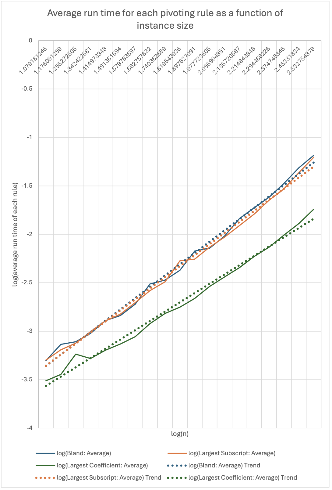
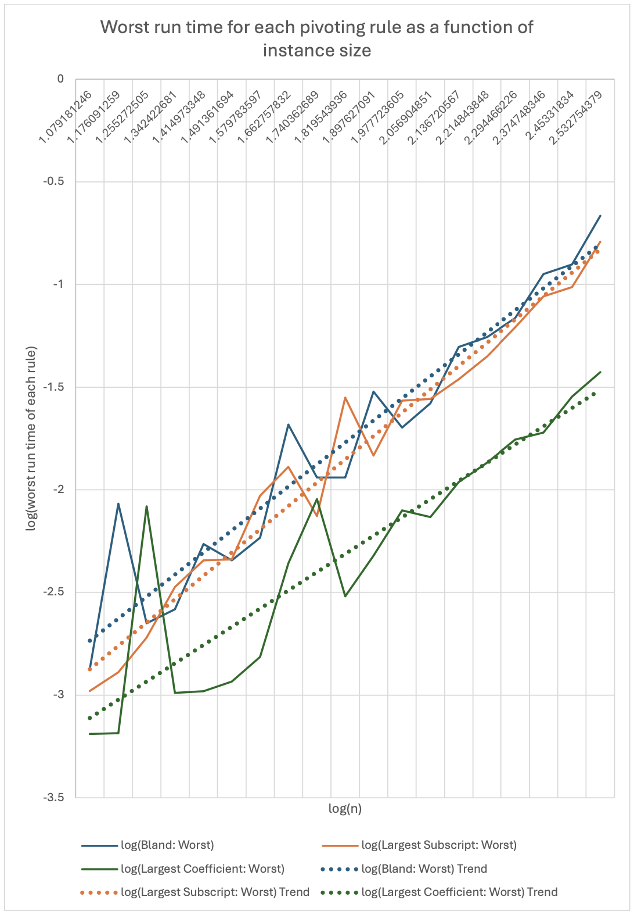

# Simplex Method Pivoting Rules: Implementation, Complexity and Run-Time Scaling

Implementation and empirical comparison of three pivoting rules for the simplex method:

- **Largest subscript rule** (the opposite of Bland's rule)
- **Largest coefficient rule** (Dantzig's rule: pivot on the most negative reduced cost)
- **Bland's rule** (baseline)

Each rule is combined with the **minimum ratio test** to choose the pivot row. I implemented the two pivot-selection functions in Python, analysed their time complexity, and benchmarked all three rules on randomly generated linear programmes of increasing size.
## Results

Run time *t* was modelled against instance size *n* with a log-log regression, log₁₀(t) = p₀ log₁₀(n) + p₁, so **p₀ is the scaling exponent** (lower is better).

| Pivoting rule | p₀ (average case) | p₀ (worst case) |
|---|---|---|
| Bland's rule | 1.456 | 1.340 |
| Largest subscript | 1.425 | 1.420 |
| **Largest coefficient** | **1.196** | **1.109** |

Both implemented rules have the same pivot-selection complexity of **O(m + n)** for an *m*-row, *n*-column tableau. Empirically, though, the **largest coefficient rule scales best**: its run time grows noticeably more slowly with instance size, in both the average and the worst case.

| Average run time | Worst-case run time |
|---|---|
|  |  |

## Repository structure

```
src/pivot_rules.py         Pivot-selection functions (largest subscript, largest coefficient)
data/timings_*.csv         Raw run times in seconds: one row per instance size n, 50 random instances each
analysis/analysis.xlsx     Excel analysis: averages, worst cases and log-log regressions
report/report.pdf          Full write-up: code, complexity analysis and results
report/report.tex          LaTeX source for the report
report/figures/            Run-time plots
```

## Using the code

```bash
pip install -r requirements.txt
```

```python
import numpy as np
from src.pivot_rules import find_pivot_largest_coefficient

# Tableau in basic form: row 0 = reduced costs, column 0 = right-hand side
tableau = np.array([...])
row, col = find_pivot_largest_coefficient(tableau)
```

Both functions assume there is at least one negative reduced cost to pivot on.

## Data

Each CSV in `data/` has one row per instance size (19 sizes, *n* = 12 to 341) and 50 columns of run times in seconds, one per random instance. Refitting the regressions from these files reproduces the coefficients in the table above.

The simplex driver and the random instance generator used to produce the timings are not included in this repository.
